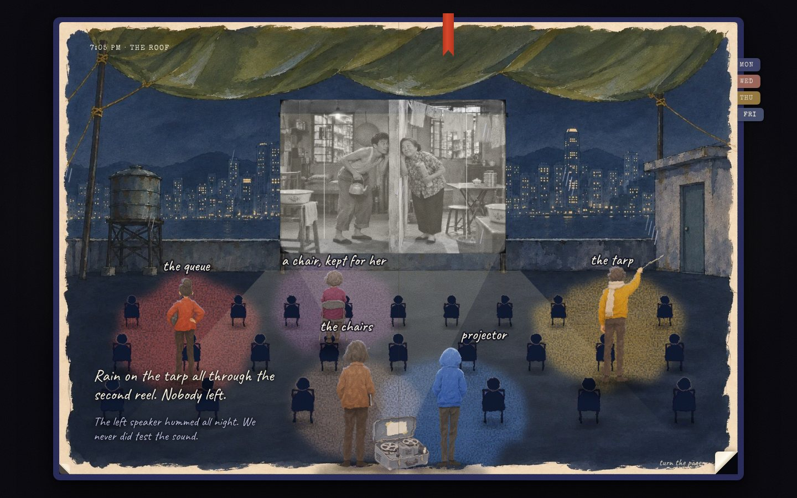

# Six Flights

A playable illustrated notebook. Co-created with Bob for CCGL.

Yan has inherited a rooftop film night, a ring of keys and a blank notebook. It is Monday. The last screening of term is on Friday, the lift is out, and the first-year who runs the projector has not answered a message in five days. You make three decisions as Yan and turn the pages to find out who ended up carrying what.



## What is here

- Twelve spreads, three decisions, 27 routes, four Fridays.
- A decision starts as three pencilled thoughts. The one you choose is written over in ink. You can also write it **in your own words**; the page reads what you meant and the story follows the nearest authored line.
- Consequences arrive as things you do and things other people leave in the book: knocking on a door, a checklist with one line you cannot tick, twenty-four chairs carried up six flights (fewer trips if people are still willing to help), a note stuck to the page, and on Saturday four entries in four other hands.
- The last painting is resolved from your route: where the film was shown, how many chairs are empty, and who is in colour.
- Ticket stubs collect in the back pocket across replays. Changing an earlier line tears out the pages after it, and asks first.
- Saved in the browser. Keyboard: arrow keys turn pages, 1/2/3 write a thought. The ribbon holds plain type, still pages, sound, print and a new notebook. Print gives the route as plain text; "Keep it as text" downloads it.

The people and the roof are invented. The three situations draw on a leadership workbook by Amanda, refined by Hannah; this is a story, not an assessment, and it names no styles and gives no score.

## The painted pass (13 November)

The notebook now uses Robert's gouache artwork throughout the playable scenes.

- **All four endings are painted rooms** with the cast as separate painted figures standing in them. Each figure has its own contact shadow and cast shadow, is lit from the screen, and takes colour or loses it with the route. One grain lies over room and people together.
- People who were given nothing to carry are still painted people; they are simply not in colour.
- The film on every screen is three frames of an invented tenement comedy, in sequence.
- Friday's storm, Wednesday's dusk, the door on the fifth floor, the stair landing and the common room at 1:40 am are painted, with the same figures and the same treatment.
- The inside cover introduces the four others with painted portraits from the revised character sheet.
- Yan's and Kit's own drawings stay drawn: the roof plan, the phone, the keys, the vent, the building with its stairs, the "who took what" diagrams, the figure lying beside the chairs.

What was chosen, from which candidate, and what was reviewed and left out: `docs/asset-provenance.md`. Full-size sources stay on the asset branches and are not in `main`.

## Run it

Node 22.13+.

```bash
npm ci
```

```bash
npm run dev
```

Then open http://127.0.0.1:5173/.

| Check | Command |
| --- | --- |
| Story, state and own-words logic (no browser) | `npm test` |
| Real browser playthroughs; needs `npm run dev` running and Playwright available | `npm run test:e2e` |
| Photograph a route | `node qa/play.mjs find,cut,name desktop qa/shots` (`phone`, `--keys`, `--still`, `--2x`) |
| Types, lint, build | `npx tsc --noEmit`, `npm run lint`, `npm run build` |

**Deploying on Vercel:** import the repository and deploy `main`. `vercel.json` sets the framework to Next.js and the build to `next build`; there are no environment variables. `npm run build` is the older Sites/Cloudflare build (`.openai/hosting.json`) and is not used by Vercel. Nothing has been deployed from this repository by Fable.

## Where things live

| Path | What |
| --- | --- |
| `app/story.ts` | Every word of the story, resolved from the three decisions. Screen, print and text export all read from here. |
| `app/state.ts`, `app/journal-store.ts` | The save: pages gated by decisions and hand-work, guarded rewrites, the pocket of stubs. |
| `app/interpret.ts` | Reading a decision written in the reader's own words. Local and instant; one seam for an optional live reader. |
| `app/Spreads.tsx` | The twelve spreads and their interactions. |
| `app/art.tsx`, `app/plates.ts` | Ink-and-wash drawings in SVG, and the registry where painted plates replace their backgrounds. |
| `app/Journal.tsx` | The book: page turns, keyboard, focus, dialogs, print. |
| `app/sound.ts` | Synthesised paper, pencil, knock and rain. No audio files. |
| `qa/` | `story-check`, `state-check`, `interpret-check` (Node) and `e2e` + `play` (Playwright). |
| `docs/creative-thesis.md` | What this is about, how the insight is derived, and what is deliberately absent. |
| `docs/asset-manifest.md` | The painted artwork to make: language, geometry, prompts, review steps. Nothing in it has been generated yet. |
| `coordination/requests/` | Six briefs for Robert: painted plates, live reader, Friday by voice, sound, a fresh-eyes playtest, the Asterwind machine. |
| `docs/screenshots/`, `docs/recordings/` | Real captures from this build: fifteen stills and a silent 110-second playthrough of one route. |
| `docs/jamie-design-backbone.md`, `docs/creative-reference-manifest.md`, `docs/fable-setup.md` | The design backbone and reference guide this was built against. |
| `docs/history/` | Notes on the earlier three-scene prototype this replaced. |
| `reference/asterwind/` | Asterwind snapshot. Reference only; not built or deployed. |

`db/`, `drizzle/`, `lib/`, `worker/`, `scripts/` and `vendor/` belong to the hosting starter and are untouched.

## Known limits

- Front-facing figures are crops of a review sheet (the portraits, Kit in his doorway). Production front poses have not been made, so Thursday's stairs still use drawn figures.
- Sound was written without being listened to. Treat it as a draft (request 04).
- No person has played this cold. The automated playthroughs prove it works, not that it lands (request 05).
- Own-words reading is a keyword reading. Oblique phrasings get "I can read that two ways" and a choice of two lines until a live reader is added (request 02).
- The Asterwind bridge is a token in the back pocket and one sentence. It opens nothing yet (request 06).
- Tested in Chromium only.

## Fonts and privacy

Caveat, Reenie Beanie, Covered By Your Grace, Patrick Hand, La Belle Aurore and Newsreader are under the SIL Open Font License; Special Elite is Apache 2.0. Licence texts are in `public/fonts/licences/`. No tracking, no network calls at runtime, nothing leaves the browser.
