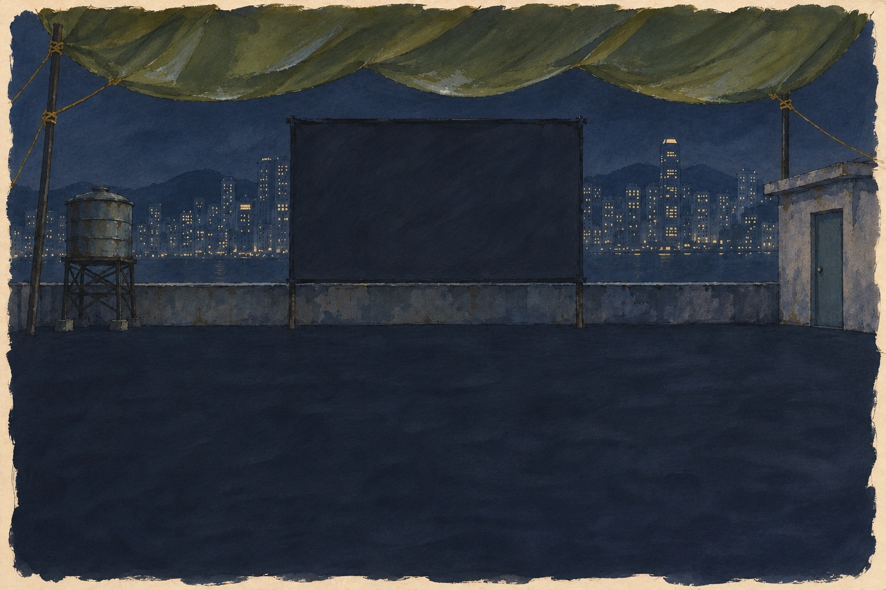

# A3: gouache clean-background refinement

Bob loves A and asked for more, committed quickly. Fable head rechecked: 9408132; no later integration/acceptance commit seen. This adds one focused A refinement without beginning the gated later-scene batch.



A3 edits the second A exploration, preserving gouache character while removing baked-in rain and bright floor reflections. The floor is calmer for live figures and handwriting. Visual inspection confirms blank screen, no people/text and no rain streaks. Geometry remains approximate: especially the doorway is still too large and screen bottom is high versus manifest; not certified within 1.5%, not production-ready. No app code/test/deploy changes. Fable may choose A1/A2 atmosphere or A3's cleaner layering and direct the final plate pass.

Generated with built-in OpenAI image generation; model/version/seed unavailable. Native1536×1024 PNG retained; WebP quality95, not upscaled. Exact executed prompt follows.

```
Refine this exact gouache-and-ink rooftop painting for Six Flights as candidate A3. Preserve its beautiful loose student-notebook brushwork, tiny window lights, indigo/slate/olive palette, cream ragged paper boundary and physical geography. Remove ALL painted falling rain strokes from sky and floor; the game animates rain separately. Keep damp concrete but make the lower half evenly dark and quiet, especially lower-left, no bright reflections. Adjust blank DARK screen rectangle to exact canvas percentages x33.6–66.4%, y20.4–50.4%; front-facing on two poles. Make horizon/parapet top50%. Olive tarp scallops occupy only top19%. Reduce left cylindrical water tank to x6–14%,y32–50%, and small right doorway x94–99%,y32–50%. Keep character colours absent: no cobalt, vermilion, marigold, plum, umber or teal. No people, chairs, projector, beam, film, bulbs, text, letters, numerals. Canvas3:2 landscape, highest available fidelity, real pooled gouache and expressive brush texture rather than clean vector art. No other creative changes.
```

## Suggested next message to Fable

I love the A gouache direction. Robert has committed the 14-candidate exploration packet and an additional clean A3 refinement in PR #2. Please review the images in docs/asset-candidates/exploration-complete/ and docs/asset-candidates/A-refinement/. You own the final art direction: choose the strongest A, select or revise the film and ephemera, and tell Robert which production plates or cutouts you need next. Keep the expressive brushwork; preserve live rain, figures, film and light where they serve your design. Integrate only what you judge ready, with geometry/mobile checks and the drawn fallback intact. Continue independent story/interaction work meanwhile; commit and push checkpoints to your working branch. No merge or public deployment yet.
