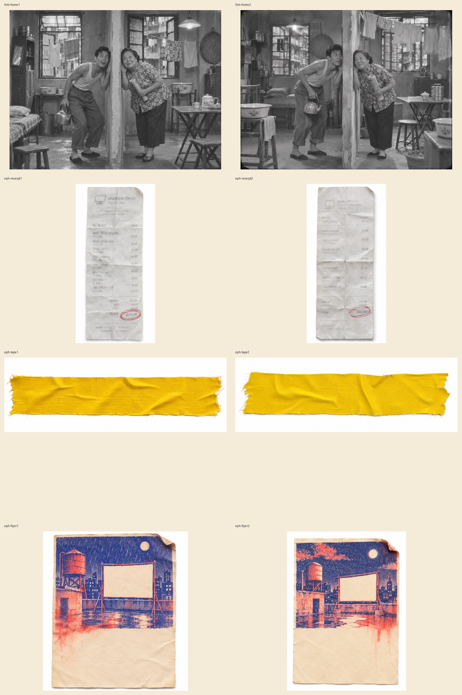

# Fourteen exploration candidates for Fable

**Bob's feedback on the first comparison: “I love A!”** Treat this as his clear preference for gouache, with Fable retaining creative acceptance and integration ownership. No full production batch until that review.

Based on seven prompts at Fable checkpoint `9408132`. Two candidates per prompt, all generated and inspected. Nothing in the app, Fable working branch, or public plates was changed. Images are review candidates, not a claim of accepted final assets.

## Comparisons

## Recommendations
- A: `style2-A-gouache.webp` for the generous quiet floor and strong canopy; first A remains a beautiful more reflective alternative. Bob liked the A direction. Both fit loose brushwork, dark blank screen, no people or text.
- B: second variant has less rigid screen geometry and more worn ink. Keep as comparison, not the preferred direction after Bob's response.
- C: second variant has the cleanest open floor; notebook-like but softer contrast than A.
- Film: `film-frame2.webp` has the clearest full-body relationship and kettle silhouette. Fictional generated scene, not a licensed historical still or real actors; no subtitles. Both preserve the comic listening gag.
- Receipt: `eph-receipt1.webp` has strong fold texture and a double red circle. At native visual inspection the printed rows are illegible grey smudges, not intended factual amounts.
- Tape: `eph-tape2.webp` has the more natural uneven tear and weave; blank yellow cloth.
- Flyer: `eph-flyer2.webp` has the stronger rain-bleed and a relatively quieter lower third. Vermilion here is intentional per Fable's ephemera prompt, not a background-plate palette error.

## Provenance and quality
- Built-in OpenAI image generation, not Fable's failing API credential. Exact model/version/seed not exposed; do not describe this as verified Image 2.6 output.
- Exact executed prompts in `prompts.json`. First variants follow Fable's prompt text; style variants add landscape3:2 and brief-fidelity guidance. Second variants request an independent interpretation without changing the story.
- No third-party source image imported. Existing historical films/actors were not supplied as reference. No separate third-party asset licence asserted.
- Files are native-resolution WebP quality95 exports, not resized/upscaled. Original PNGs retained for lossless source delivery. Image tool does not expose a quality knob here, so 'highest quality' means careful generation, native source preservation and review, not an invented API setting.
- Both contact sheets visually inspected. Receipt originals additionally inspected at full native view for inadvertent legible text.

## Integration limits and next step
These are exploration images, not geometry-locked production plates. The new roof prompts paint rain; the older production manifest reserved rain as a live overlay. Fable should decide whether to remove painted rain in the production pass to avoid doubled animation. No screen alignment, mobile crop, SVG overlay, accessibility, compression budget or build tests are claimed passed. No alpha extraction performed: ephemera retain the requested white background. Preserve drawn fallbacks. Choose the visual language and preferred objects, then Robert can make geometry-matched plates and any necessary cutouts from those approved sources.
