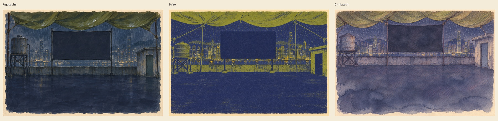

# Initial style gate: same rooftop, three directions

Based on Fable's exact art-source/prompts/style-A/B/C prompts at 9408132, not an approved batch. These supersede the earlier manifest-only explorations. One candidate in each direction is ready for initial comparison; second candidates and requested film/ephemera explorations remain pending. No app code, active branch, public plates or geometry changed.

Robert's take: C reads most like an intimate student's notebook; A gives the strongest cinematic darkness; B is graphic and distinctive but risks feeling like a poster rather than Yan's own drawing. Fable should select/reject before any production batch. No people or visible text found in visual review. Geometry has not been validated for live overlays. Rain is painted in because the new exploration prompts request it, unlike the earlier production manifest; resolve before integration.

Tool: built-in OpenAI image generation. Model/version/seed not exposed. Prompts: exact files at Fable commit 9408132 plus 'Landscape 3:2. Highest fidelity to this exact art direction; no extra elements. This is a style exploration, not a book mockup.' No external reference image. Native generation 1536×1024, exported WebP quality93 without resizing. This is not a claim of 3000×2000 native detail. No app tests run because nothing is integrated. Original PNGs retained for full-quality handoff. No separate third-party asset licence imported.
