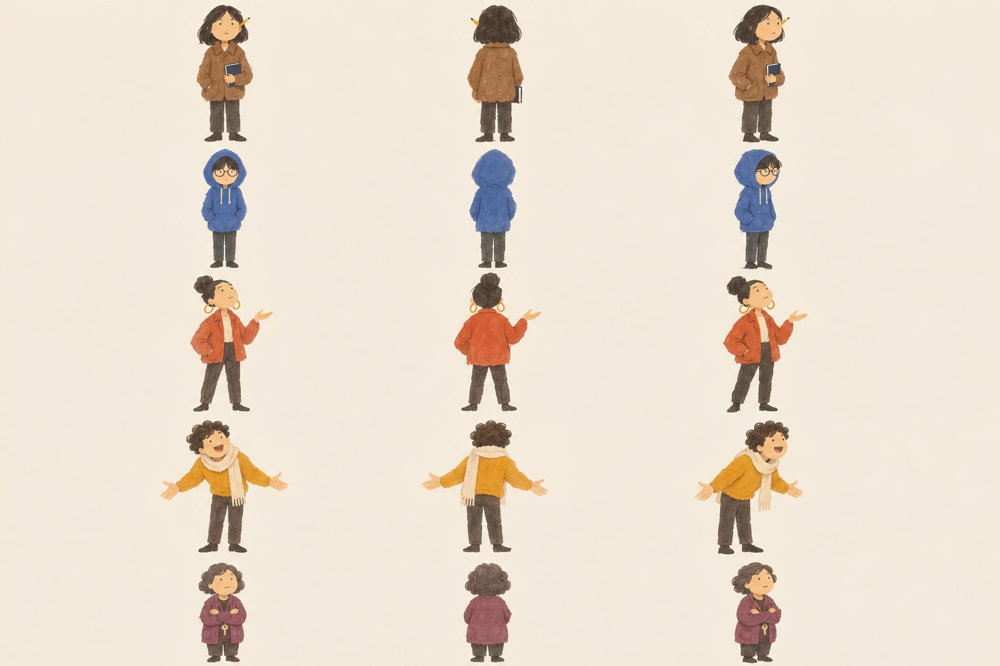
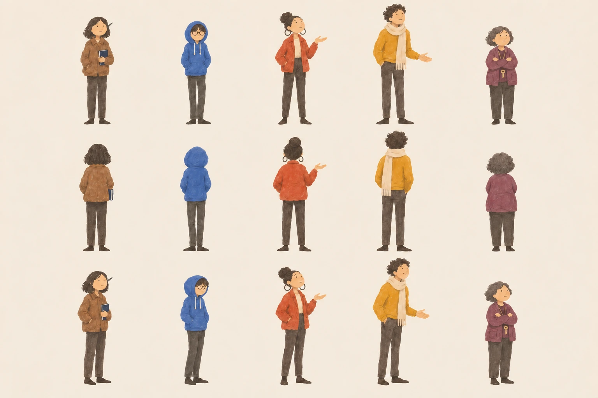

# Character gate: Fable review requested

Five people, each front/back/three-quarter, following request09 at2fb11fa. Rows: Yan, Kit, Priya, Tomás, MrsLeung. No derivative people have been generated. Please approve/redirect this identity and style sheet before those poses proceed.



Provisional: faces/minimal gouache and identifying traits visually checked; Priya/Tomás fronts are somewhat angled. Native1536×1024 sheet is a design review, NOT fifteen900px production cutouts. Those require generation after your direction, with real alpha. Independent plates, film, objects, places and surfaces are proceeding under Bob's request for speed.


## Revised gate C01 (Request 10 / Request 11)



`C01-five-people-revised.webp` is the final revised sheet from `C00-revised-adult-proportions.png` in the character-follow-up archive. Native 1536×1024, opaque WebP quality 92, no crop or resize. Five columns: Yan, Kit, Priya, Tomás, Mrs Leung. Rows: front, back, three-quarter. Adult proportions, graphite-grey Yan pencil, dark Priya hoops and closed Tomás smile are preserved. This is a review sheet, not approval for front-facing production poses. No front-facing production poses were made.

Tool: built-in OpenAI image generation. Underlying model/version/seed not exposed. Original C00 style reference was used for the revision. No new image generation in this delivery pass. Original final PNG remains intact in the archived `Six-Flights-character-followup-20261113.zip`.

### Revision prompt as run

```text
Use case: identity-preserve
Asset type: revised character model sheet for the interactive illustrated notebook “Six Flights”.
Input image: Image 1 is the existing approved STYLE and IDENTITY reference. Preserve its exact loose matte gouache hand, soft irregular painted edges, sparse blue-black ink, cream paper, simple faces, five characters, hair and clothes. This is a targeted adult-proportion and accessory correction, NOT a redesign.
Primary request: ONE clean production REVIEW sheet with exactly fifteen separated full-body figures, five characters each in front, back, and three-quarter views. Arrange FIVE COLUMNS by THREE ROWS so heights can be compared: columns left to right Yan, Kit, Priya, Tomás, Mrs Leung; top row FRONT; middle row BACK; bottom row THREE-QUARTER. Feet share a baseline within each row. All full bodies and feet visible, ample blank cream separation, no overlap, no text or labels, no grid lines. Wide landscape page at high resolution.
Critical proportion correction: they are four UNIVERSITY STUDENTS aged 18–24 and one woman in her sixties, NOT children. Elongate legs and torsos, reduce head size relative to body. The four standing students are about FIVE HEADS TALL, measured crown to sole. Keep minimalist faces, no realistic anatomy or detailed eyes. Height order in EVERY row is TOMÁS tallest, PRIYA next, YAN next, KIT a little shorter, MRS LEUNG clearly shortest. Preserve gentle stylization and round simple heads while making proportions unmistakably adult; no chibi or nursery-book bodies.
YAN, column 1: young adult woman, dark chin-length bob; umber #9a6a45 jacket, dark trousers and shoes. Plain natural dark WOOD/GRAPHITE-GREY pencil behind one ear, NO yellow. Closed NAVY notebook always in one hand held close; naturally hidden partly in back view. Slightly hunched, thoughtful attention. Minimal two-dot face and short quiet mouth. Adult slim proportions.
KIT, column 2: young adult man, the slightest and narrowest student. Cobalt #2f62b8 hoodie with hood UP, dark trousers/shoes. Round glasses; long dark fringe comes down OVER TOP EDGE of the glasses. Narrow tucked-in shoulders, hands inside kangaroo pocket, weight on one foot, a little shorter than Yan. Very slender adult legs. Back view no face or glasses visible.
PRIYA, column 3: young adult woman, taller than Yan and shorter than Tomás. Vermilion #d9472b jacket, dark trousers/shoes, HIGH ROUND dark hair bun. Large thin DARK charcoal hoop earrings, NOT gold/yellow. Chin up, confident weight, one simple hand mid-gesture. Minimal face and composed short mouth.
TOMÁS, column 4: young adult man, clearly the TALLEST and LANKIEST: long legs, slim longer torso, cloud of dark curls. Marigold #e2a31c jumper, cream scarf, dark trousers/shoes. Slight forward lean, welcoming but not childish. CLOSED LOPSIDED small smile in BOTH face-visible views, no wide-open mouth. Arms resting easily with one hand lightly opening, not both outstretched. Middle row is the back of head only, NO face. Preserve scarf and curls.
MRS LEUNG, column 5: woman in her sixties, CLEARLY SHORTEST, square planted stance, short permed dark-grey hair, plum #7d3c6e cardigan, dark trousers/shoes, key on a cord visible in front and three-quarter. Arms FOLDED. Preserve reference identity, practical calm short mouth, mature bearing; do not make her a student or add realistic detail. Modestly elongate legs only if needed to retain adult rather than toddler proportions.
Style/medium: affectionate student notebook drawings, loose gouache and a LITTLE ink, matte pigment texture, slight pencil underdrawing, flat colour shapes, very little shading. Keep reference's gentle whole-person portrayal. Waiting people have their own weight and attention, never blank mannequins.
Constraints: EXACTLY five characters times three views. Same identity, body proportions, colours and garments in all views. Each identifying hue belongs only to that person's own garment. Plain warm cream #f4ecd9 opaque background, no photographic book/page, no shadows or scenery, no frames, no labels, no watermark. No 3D, no glossy rendering, no anime, no facial detail, no realistic hands, no infantilized bodies.
```

### Graphite-pencil correction prompt as run

```text
Use case: precise-object-edit. This image is the revised Six Flights character review sheet. Change ONLY the two tiny pencils behind Yan's ear in the LEFTMOST column, in TOP and BOTTOM rows: replace their warm yellow/orange wood body with unmistakable neutral DARK GRAPHITE GREY (#595653), a small grey pencil, not yellow or gold. Preserve absolutely everything else: exact 15 figures, geometry, all adult body proportions, colours, facial marks, silhouettes, pose, hair, garments, gouache brushwork, cream background, resolution and layout. Do NOT redraw or resize any person; do NOT add anything. This is only a graphite-grey recolour of these two small pencils.
```
