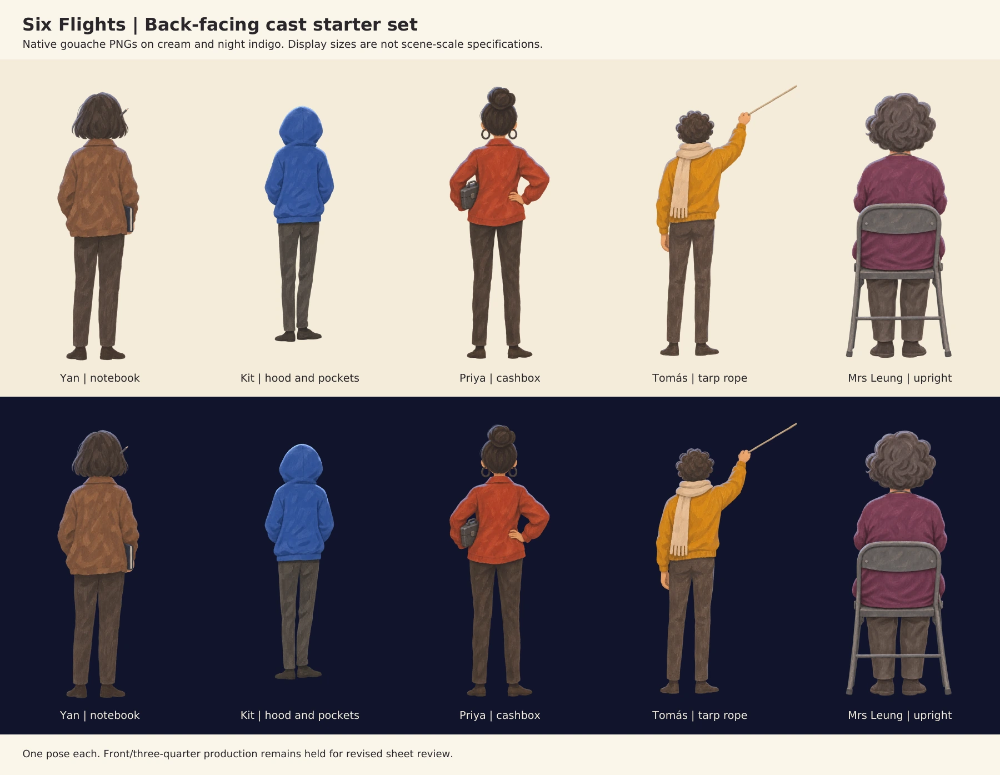

# Five back-facing figures

Native 1024×1536 RGBA PNGs, **byte-identical to the final archived cutouts**. Real alpha with zero-alpha surroundings and soft partial-alpha edges (range 0–254), not colour-keyed or painted checkerboards. Visible artwork is about 1253–1444 pixels tall. Retained at native resolution rather than shrinking to roughly 900 pixels. No background, floor, beam or new cast shadow is baked in.

Tool: built-in OpenAI image generation, model/version/seed not exposed. Reference: final revised character sheet. No new images or poses generated in this delivery. Full source archive: `Six-Flights-character-followup-20261113.zip`; native PNGs remain intact.

| Request 11 name | Archived source | Pose |
| --- | --- | --- |
| `yan-back.png` | `B01-Yan-standing-notebook.png` | Standing, notebook held at side |
| `kit-back.png` | `B02-Kit-standing-hood.png` | Standing, hood up and hands in pocket |
| `priya-back.png` | `B03-Priya-cashbox.png` | Standing, cashbox under left arm |
| `tomas-back.png` | `B04-Tomas-holding-rope.png` | Standing, right hand holding a rope |
| `leung-back.png` | `B05-Mrs-Leung-seated.png` | Seated upright on a folding chair |



The contact sheet is a q92 WebP review copy, not a source cutout. See [source-alpha-qc.json](source-alpha-qc.json) for source dimensions, alpha statistics, visible bounds and SHA-256; its archived filenames map above.

## Integration notes

These are five independent live layers. Canvas height does not encode relative height: scale to C01 (Tomás > Priya > Yan > Kit, with Mrs Leung seated). Align feet or chair feet to the floor. The standing Tomás holds a rope that exits the upper-right edge. It is **not a neutral hands-down pose**; only use it where the scene supplies a plausible rope. P04 has no tarp, and P05 is indoors, so do not pretend that pose is a seamless match for every ending. Mrs Leung is seated, not the held front-facing doorway pose.

No visible rectangular matte or broad halo was seen on the archived cream/indigo composite. Soft near-transparent dust is retained. Final dark-roof placement, live colour response and phone/desktop review remain Fable's integration checks. The brush detail is richer than the tiny identity sheet. The cashbox shape should be compared with the separate prop.

## Executed prompts

### yan-back.png

```text
Use case: illustration-story
Asset type: single reusable BACK-VIEW CHARACTER CUTOUT for Six Flights rooftop film-screening scene.
Reference image: the five-column model sheet supplies ONLY character identity, proportions, clothing and gouache technique. Do not reproduce the sheet.
Style: same affectionate student notebook hand as reference, matte textured gouache with a little blue-black ink, irregular soft painted edges, flat simplified shapes, minimal anatomy, slight pencil underdrawing. NOT rendered, no gradients or 3D modelling.
Proportions: unmistakably ADULT UNIVERSITY STUDENT, about FIVE heads tall, longer slim legs as revised reference. Entire person visible head to toe; no cropping, no front or profile face at all.
Night lighting: screen is in FRONT OF the person and therefore away from viewer. A subtle cool-pale rim on hair/hood and shoulder edges; back planes gently shaded but retain FULL garment local colour so the integrator can grade it live. No glow halo, beam, shadow surface, sky, floor or scene.
Canvas: portrait 1024x1536 or highest appropriate native resolution. One full-body figure about 1100–1250 px tall, centred with clear transparent breathing room. Actual alpha transparency outside the painted figure, no white/cream matte, no checkerboard painted into image. No ground or cast shadow. No text, labels, watermark, additional objects or people. Preserve whole-person attention, not a blank mannequin.
Subject/pose: YAN, the LEFTMOST person in the reference. Young adult woman seen STRICTLY from directly BEHIND, dark chin-length bob with a tiny GRAPHITE-GREY pencil tucked by ear, umber #9a6a45 jacket, neutral dark trousers and shoes. Closed small navy notebook held close in her LEFT hand at her side, only its edge visible from behind, never open. She is standing beside an off-frame projector watching the film; shoulders a little hunched, weight gently settled onto one leg, attentive and thoughtful. Both feet planted. Arms relaxed, no face, no facial profile, no visible eyes. NO projector/table in this asset.
```

### kit-back.png

```text
Use case: illustration-story
Asset type: single reusable BACK-VIEW CHARACTER CUTOUT for Six Flights rooftop film-screening scene.
Reference image: the five-column model sheet supplies ONLY character identity, proportions, clothing and gouache technique. Do not reproduce the sheet.
Style: same affectionate student notebook hand as reference, matte textured gouache with a little blue-black ink, irregular soft painted edges, flat simplified shapes, minimal anatomy, slight pencil underdrawing. NOT rendered, no gradients or 3D modelling.
Proportions: unmistakably ADULT UNIVERSITY STUDENT, about FIVE heads tall, longer slim legs as revised reference. Entire person visible head to toe; no cropping, no front or profile face at all.
Night lighting: screen is in FRONT OF the person and therefore away from viewer. A subtle cool-pale rim on hair/hood and shoulder edges; back planes gently shaded but retain FULL garment local colour so the integrator can grade it live. No glow halo, beam, shadow surface, sky, floor or scene.
Canvas: portrait 1024x1536 or highest appropriate native resolution. One full-body figure about 1100–1250 px tall, centred with clear transparent breathing room. Actual alpha transparency outside the painted figure, no white/cream matte, no checkerboard painted into image. No ground or cast shadow. No text, labels, watermark, additional objects or people. Preserve whole-person attention, not a blank mannequin.
Subject/pose: KIT, SECOND column of the reference. Young adult man seen STRICTLY from directly BEHIND, cobalt #2f62b8 hoodie with HOOD UP, dark trousers and shoes. Slightest and narrowest student, very slender adult legs, narrow tucked shoulders, hands inside kangaroo pocket, weight on his RIGHT foot, left knee gently relaxed, taking little space but watching the distant film intently. A little shorter in body proportions than Yan. NO face, no eyes/glasses, no visible fringe seen through the back of his hood. No props.
```

### priya-back.png

```text
Use case: illustration-story
Asset type: single reusable BACK-VIEW CHARACTER CUTOUT for Six Flights rooftop film-screening scene.
Reference image: the five-column model sheet supplies ONLY character identity, proportions, clothing and gouache technique. Do not reproduce the sheet.
Style: same affectionate student notebook hand as reference, matte textured gouache with a little blue-black ink, irregular soft painted edges, flat simplified shapes, minimal anatomy, slight pencil underdrawing. NOT rendered, no gradients or 3D modelling.
Proportions: unmistakably ADULT UNIVERSITY STUDENT, about FIVE heads tall, longer slim legs as revised reference. Entire person visible head to toe; no cropping, no front or profile face at all.
Night lighting: screen is in FRONT OF the person and therefore away from viewer. A subtle cool-pale rim on hair/hood and shoulder edges; back planes gently shaded but retain FULL garment local colour so the integrator can grade it live. No glow halo, beam, shadow surface, sky, floor or scene.
Canvas: portrait 1024x1536 or highest appropriate native resolution. One full-body figure about 1100–1250 px tall, centred with clear transparent breathing room. Actual alpha transparency outside the painted figure, no white/cream matte, no checkerboard painted into image. No ground or cast shadow. No text, labels, watermark, additional objects or people. Preserve whole-person attention, not a blank mannequin.
Subject/pose: PRIYA, THIRD column in the reference, young adult woman, second-tallest and confident. Seen STRICTLY from directly BEHIND. High round dark hair BUN, large DARK charcoal hoop earrings, vermilion #d9472b jacket, dark trousers and shoes. She stands watching the film with a small dented rectangular dark grey metal cashbox tucked firmly under her LEFT arm at her hip; that elbow presses naturally against it, right forearm bent and right hand resting lightly on her own waist. Cashbox is modest sized, plainly closed, with tiny handle/latch, no numbers or markings. Weight firmly on one leg and chin slightly lifted but NO face or profile visible. Calm capable attention. Do not change bun or add gold earrings.
```

### tomas-back.png

```text
Use case: illustration-story
Asset type: single reusable BACK-VIEW CHARACTER CUTOUT for Six Flights rooftop film-screening scene.
Reference image: the five-column model sheet supplies ONLY character identity, proportions, clothing and gouache technique. Do not reproduce the sheet.
Style: same affectionate student notebook hand as reference, matte textured gouache with a little blue-black ink, irregular soft painted edges, flat simplified shapes, minimal anatomy, slight pencil underdrawing. NOT rendered, no gradients or 3D modelling.
Proportions: unmistakably ADULT UNIVERSITY STUDENT, about FIVE heads tall, longer slim legs as revised reference. Entire person visible head to toe; no cropping, no front or profile face at all.
Night lighting: screen is in FRONT OF the person and therefore away from viewer. A subtle cool-pale rim on hair/hood and shoulder edges; back planes gently shaded but retain FULL garment local colour so the integrator can grade it live. No glow halo, beam, shadow surface, sky, floor or scene.
Canvas: portrait 1024x1536 or highest appropriate native resolution. One full-body figure about 1100–1250 px tall, centred with clear transparent breathing room. Actual alpha transparency outside the painted figure, no white/cream matte, no checkerboard painted into image. No ground or cast shadow. No text, labels, watermark, additional objects or people. Preserve whole-person attention, not a blank mannequin.
Subject/pose: TOMÁS, FOURTH column in the reference, young adult man, tallest/lankiest of the students, long legs and slim torso. Seen STRICTLY from directly BEHIND. Cloud of dark curls, marigold #e2a31c jumper, cream scarf wrapped at neck with a single visible loose tail, dark trousers/shoes. RIGHT arm reaches naturally above his head to grasp one thin off-white/tan taut rope, which continues straight diagonally to the upper right edge of the cutout; LEFT arm rests at his side. He keeps a tarp rope steady while watching the film, leaning his weight a little forward, feet clearly supporting him. Only ONE rope strand, anatomically clear simple hand closing on it. The tarp/canopy itself is not pictured. NO face or profile, no grin visible. No background or poles.
```

### leung-back.png

```text
Use case: illustration-story
Asset type: single reusable BACK-VIEW CHARACTER CUTOUT for Six Flights rooftop film-screening scene.
Reference image: the five-column model sheet supplies ONLY character identity, proportions, clothing and gouache technique. Do not reproduce the sheet.
Style: same affectionate student notebook hand as reference, matte textured gouache with a little blue-black ink, irregular soft painted edges, flat simplified shapes, minimal anatomy, slight pencil underdrawing. NOT rendered, no gradients or 3D modelling.
Proportions: unmistakably ADULT UNIVERSITY STUDENT, about FIVE heads tall, longer slim legs as revised reference. Entire person visible head to toe; no cropping, no front or profile face at all.
Night lighting: screen is in FRONT OF the person and therefore away from viewer. A subtle cool-pale rim on hair/hood and shoulder edges; back planes gently shaded but retain FULL garment local colour so the integrator can grade it live. No glow halo, beam, shadow surface, sky, floor or scene.
Canvas: portrait 1024x1536 or highest appropriate native resolution. One full-body figure about 1100–1250 px tall, centred with clear transparent breathing room. Actual alpha transparency outside the painted figure, no white/cream matte, no checkerboard painted into image. No ground or cast shadow. No text, labels, watermark, additional objects or people. Preserve whole-person attention, not a blank mannequin.
Subject/pose: MRS LEUNG, FIFTH column in the reference. Mature woman in her sixties, shortest cast member, square practical bearing. Seen STRICTLY from directly BEHIND, seated very upright on a simple utilitarian dark-grey metal FOLDING CHAIR. Short softly permed dark-grey hair; plum #7d3c6e cardigan; neutral dark trousers and practical shoes. Arms folded in front of her, mostly occluded by her torso. Back of cardigan, both elbows, chair back, seat and all chair legs visible; both feet planted tidily. Tiny rear glimpse of neck cord can show but key is on the unseen FRONT of her body, never on her back. Her upright posture carries quiet intent as she watches the film. Preserve her slightly broad/compact adult silhouette; NOT a child. Minimal folded chair structure, no background or floor. NO face or profile.
```

### Mrs Leung rear-pocket correction

```text
Use case: precise-object-edit. Input is the BACK VIEW of Mrs Leung seated on a folding chair. Preserve exactly her silhouette, hairstyle, proportions, plum colour, pose, folding chair, legs and shoes, lighting, gouache texture, framing and real alpha transparency. Correct only a clothing construction error: REMOVE the two rectangular patch pockets that appear on the LOWER BACK of her plum cardigan. The back of the cardigan should be one continuous plain plum painted fabric, with natural simple folds, NO rear patch pockets and no replacement decoration. Leave the chair in front of her back exactly as it is. Do not add a face, front-facing key, text or background. Keep transparent background.
```
